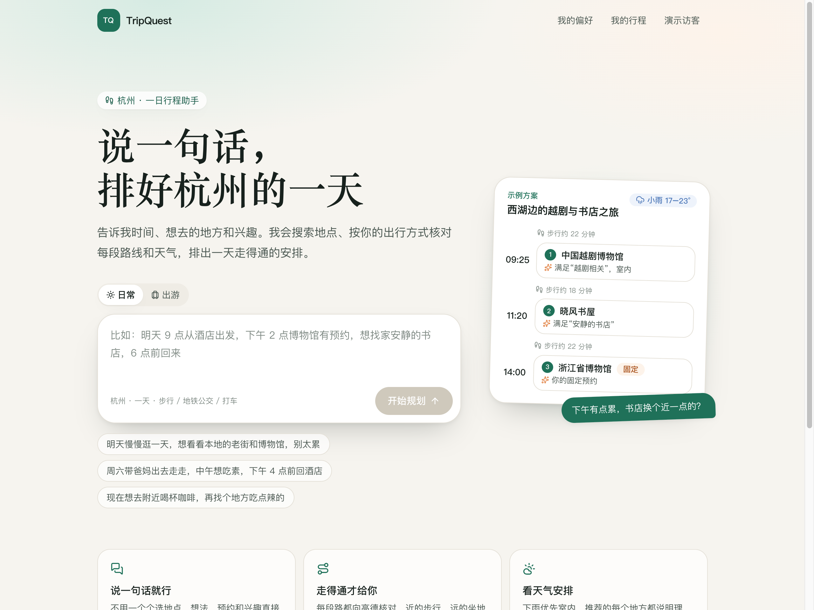
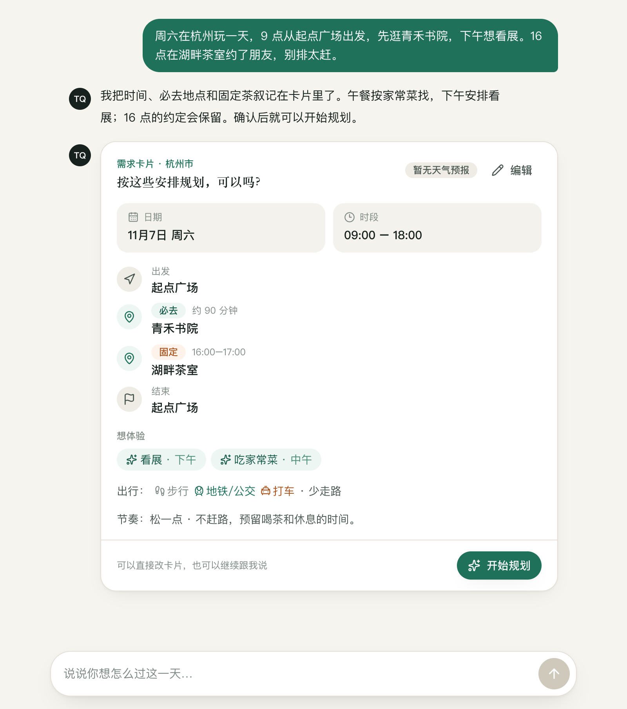
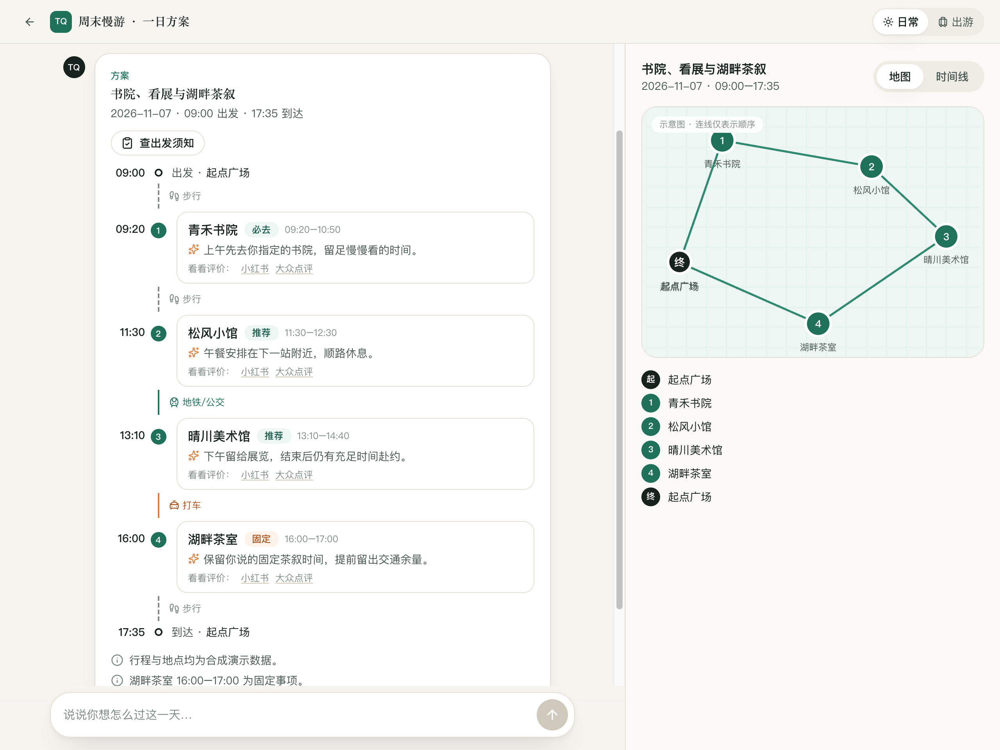
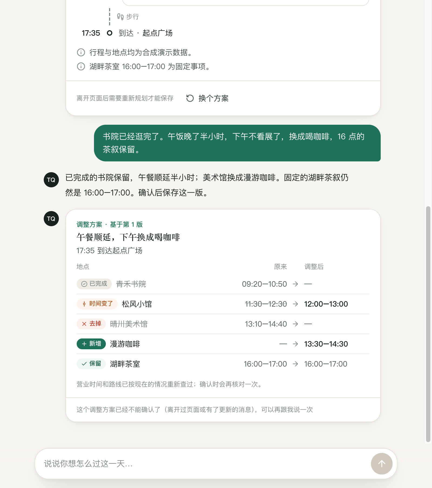
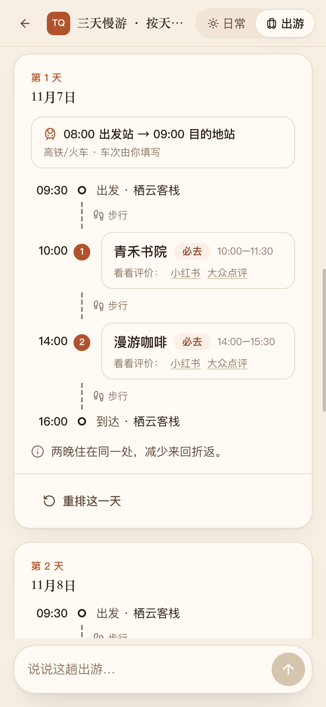
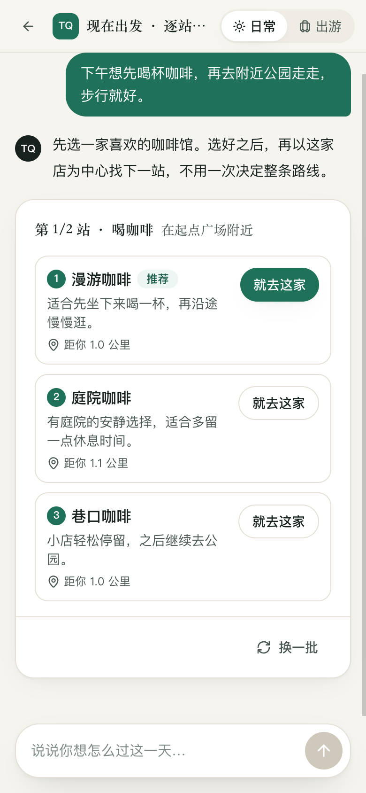
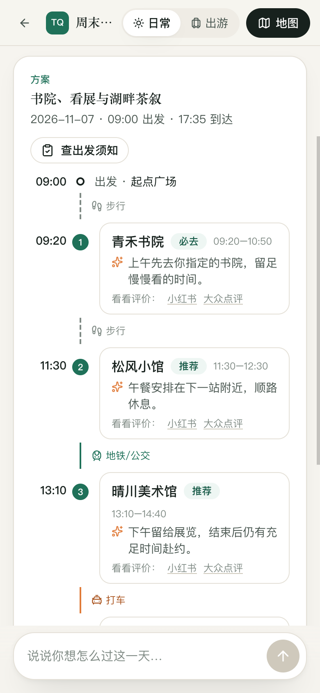
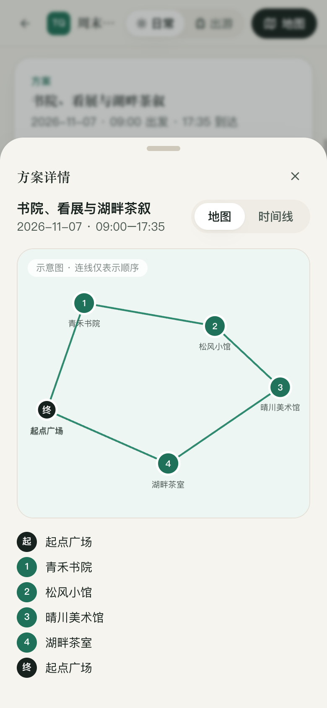

# TripQuest

**说出想法，规划行程；途中有变，继续调整。**

TripQuest 是一个面向国内自由行的 AI 旅行助手。把时间、地点、兴趣和固定安排告诉它，先确认需求，再查看方案；出发后，也可以继续用对话记录进度、替换地点和调整后续行程。

模型负责理解和提出候选，代码核对时间、路线与约束，用户确认后才保存。

[界面演示](#界面演示) · [工程设计](#工程设计) · [本地启动](#本地启动) · [检查](#检查) · [源码结构](#源码结构)



[查看高清原图](assets/screenshots/01-home.png)

以下为本地应用的 **2 倍像素密度 PNG 实拍图**，点击图片或“查看高清原图”可放大查看。行程使用手工构造的合成数据与模拟服务响应，地图为访问顺序示意图；首页右侧是应用内置的示例方案。

## 可以做什么

| 场景 | 你可以这样说 | 应用会给出什么 |
| --- | --- | --- |
| 一日规划 | “周六逛书院，下午看展，16 点的茶叙保留，别太赶。” | 可编辑需求卡、分段出行方式、带时间的方案与地点顺序 |
| 现在出发 | “先喝杯咖啡，再去附近公园走走。” | 每一步提供候选，选好后围绕上一站找下一站 |
| 多日出游 | “玩三天，两晚住同一家，第一天早上到、第三天晚上回。” | 日期、固定交通、每晚住处，以及分到各天的行程 |
| 途中调整 | “午饭晚了半小时，下午不看展了，换成喝咖啡。” | 原来与调整后的对照，保留已完成事项和固定安排 |
| 旅行问答 | “苏堤和白堤各有什么故事？” | 结合资料库或联网查询的回答，附网页或段落出处 |

此外，还支持邀请码注册、按用户隔离的数据、经确认保存的长期偏好、每日额度，以及长任务的刷新重连、停止和中断后继续。

技术栈：**TypeScript · Next.js · React · Tailwind CSS · LangGraph.js · LangChain.js · Zod · PostgreSQL / pgvector · Drizzle · Better Auth · Vitest · pnpm**。

## 界面演示

### 1. 先把需求说清楚

日期、活动时段、必去地点、固定预约、兴趣、交通方式和节奏会集中到一张卡片里。可以直接编辑，也可以继续用对话补充。缺少必要信息时，卡片会列出还需要什么。



[查看高清原图](assets/screenshots/02-requirements.png)

### 2. 同时看安排和空间顺序

一日方案按站点展示时间、交通方式和推荐理由。“必去”和“固定”会单独标记；桌面端右侧可以在地图和时间线之间切换。



[查看高清原图](assets/screenshots/03-day-plan.png)

### 3. 途中有变，先看差异

“已完成”“保留”“时间变了”“新增”“去掉”分别显示。下面的示例保留已逛完的书院和 16 点的茶叙，把午餐顺延，并用咖啡馆替换下午的美术馆。



[查看高清原图](assets/screenshots/04-adjustment.png)

候选绑定生成时的基础版本；重新打开对话或出现更新后，旧候选会锁定，重新生成后才能确认。

### 4. 把交通、住处和每天的安排放在一起

在首页选择“出游”，会切换到暖色的出游主页面。可以直接输入日期、目的地、交通和想玩的内容，也可以从示例开始。


[查看出游首页高清原图](assets/screenshots/12-outing-home.png)

出游模式支持 **1–7 天**，一天内也可以跨城。固定交通会切开当天的可用时段，每晚住处作为衔接点；地点先分到各天，再逐天生成。某一天不满意，可以只重排那一天。

<table>
  <tr>
    <th width="50%">固定交通与连住安排</th>
    <th width="50%">按天展示，支持单日重排</th>
  </tr>
  <tr>
    <td align="center"><a href="assets/screenshots/07-transport-lodging-mobile.png"></a></td>
    <td align="center"><a href="assets/screenshots/08-outing-day-mobile.png"></a></td>
  </tr>
</table>

<details>
<summary>展开查看出游需求卡：日期、每日时段和指定第几天去的地点</summary>


</details>

### 5. 也可以只挑下一站，或问一个旅行问题

短途模式逐站选择，展示候选理由和相对距离；资料问答则提供出处入口，可以继续查看来源。两类交互都保留在对话里。

<table>
  <tr>
    <th width="50%">逐站挑选</th>
    <th width="50%">带资料出处的回答</th>
  </tr>
  <tr>
    <td align="center"><a href="assets/screenshots/05-short-mobile.png"></a></td>
    <td align="center"><a href="assets/screenshots/09-knowledge-mobile.png"></a></td>
  </tr>
</table>

### 6. 手机端保留对话，按需展开方案

手机上以对话为主，点击顶部“地图”打开方案面板；面板里继续切换地图与时间线。

<table>
  <tr>
    <th width="50%">行程对话</th>
    <th width="50%">方案与地图抽屉</th>
  </tr>
  <tr>
    <td align="center"><a href="assets/screenshots/10-plan-mobile.png"></a></td>
    <td align="center"><a href="assets/screenshots/11-map-mobile.png"></a></td>
  </tr>
</table>

## 工程设计


- **专门 Agent 协作**：对话按意图调用需求理解、改行程、资料查询、建议或陪聊模块；出游总控复用一日规划，再做整趟审查。
- **确定性保护**：Zod 检查结构，领域代码检查时间、交通衔接、固定事项、已完成事实与修改范围。未知路线保留为未知，无可行方案时说明原因。
- **确认与版本保护**：候选带基础状态和指纹，服务端再次核对权限、版本、硬约束与幂等性，防止旧候选覆盖新安排。
- **可观察、可恢复**：记录父子运行、工具调用与共用预算。业务计划、对话、长任务和图检查点分开管理；演示任务由同仓库 Worker 与 PostgreSQL 检查点恢复，真实对话任务按已保存的业务结果继续。
- **检索链路完整**：自写语料 → 切分 → 嵌入 → pgvector 与关键词混合召回 → 重排 → 带段落引用的回答。

详细架构、关键取舍与源码阅读顺序见 [工程导读](PROJECT_CONTEXT.md)。

## 本地启动

需要 Node.js 24（见 `.nvmrc`）、pnpm 12.3.4 和可运行 Docker Compose 的环境。

```bash
pnpm install --frozen-lockfile
cp .env.example .env
cp agent-models.example.json agent-models.local.json
```

编辑 `.env`，为 `BETTER_AUTH_SECRET`、`PLANNING_PLACE_TOKEN_SECRET`、`PLANNING_DRAFT_RECEIPT_SECRET` 分别填写独立随机值（至少 32 字节）。每个值可以用下面的命令单独生成：

```bash
node -e "console.log(require('node:crypto').randomBytes(32).toString('hex'))"
```

启动数据库并执行迁移，然后为本地管理账号设置密码：

```bash
pnpm db:up
pnpm db:migrate
pnpm users set-password owner
pnpm dev
```

访问 [http://localhost:3000](http://localhost:3000)，以 `owner` 登录。`pnpm users invite` 创建一次性邀请码。`pnpm dev` 同时管理 Web 和演示任务 Worker；`pnpm db:down` 停止数据库并保留数据。

此副本的 Compose 项目名为 `tripquest-public`，数据库默认只监听 `127.0.0.1:55433`，使用独立命名数据卷。更改端口时同步修改 `.env` 中的两个数据库连接地址。示例密码仅用于本机开发。

### 无外部密钥的演示

默认关闭真实地图与模型调用。若要使用虚构地点生成演示草稿，在 `.env` 设置：

```dotenv
PLANNING_PLACE_SOURCE=fixture
PLANNING_GENERATION_ENABLED=true
PLANNING_MODEL_MODE=scripted
PLANNING_SAVE_ENABLED=true
```

重启 `pnpm dev`，登录后访问 `/planning/new`。演示地点、路线和决策均为虚构/规则数据；对话规划需要下一节的真实服务配置。

不启动 Web 或数据库也可以运行虚构世界中的基线和脚本策略评测：

```bash
pnpm eval:baseline
pnpm eval:agent -- --mode scripted
```

### 本机真实对话规划

真实地点与对话规划目前仅允许在 **development 的本机个人模式** 中启用。`pnpm build` 验证生产打包，生产运行不会开启这一模式。

在自己的 `.env` 中配置：

```dotenv
PLANNING_PLACE_SOURCE=amap
REAL_PLACE_SAVE_ENABLED=true
AMAP_WEB_SERVICE_KEY=<你的高德 Web 服务密钥>
AGENT_LIVE_ENABLED=true
AGENT_MODEL_PROFILE=deepseek-flash
DEEPSEEK_API_KEY=<你的模型服务密钥>
PLANNING_SAVE_ENABLED=true
```

`agent-models.local.json` 配置模型适配、服务地址、模型名称和输出上限；密钥只通过环境变量读取。修改这些值以匹配自己的服务账号。启动后在 `/plan/new` 使用对话规划。

可选能力：

| 能力 | 配置 |
| --- | --- |
| 高德底图 | `PLANNING_MAP_MODE=amap`，填写独立的 `AMAP_JS_API_KEY` 与 `AMAP_JS_SECURITY_CODE` |
| 联网问答 | `WEB_SEARCH_ENABLED=true` 与 `DEEPSEEK_API_KEY` |
| 知识库 | `DASHSCOPE_API_KEY`、`KNOWLEDGE_ENABLED=true`，执行 `pnpm rag:ingest` |
| 手机定位测试 | 同一 Wi-Fi 下运行 `pnpm dev:https`，使用终端提示的 HTTPS 地址 |

真实请求会消耗各服务额度。地图来源、路线耗时与停留估计会展示相应说明；预约、营业和票务仍需确认。高德实时数据按本机个人模式使用，只长期保存地点编号、名称和自有计划，坐标、地址、路线、营业及天气在展示时查询。`pnpm real-places:purge --yes` 可清理本地真实地点行程与相关对话。不要将服务数据、运行记录或用户位置加入仓库。

## 检查

```bash
pnpm typecheck
pnpm lint
pnpm build
pnpm test:domain
pnpm test:application
pnpm test:providers
pnpm test:agent
pnpm test:evals
```

数据库、认证、Web、Worker 与知识库存储的集成测试使用 `TEST_DATABASE_URL`，数据库名必须以 `_test` 结尾。测试只传测试连接，不加载带真实服务开关的整份 `.env`。Worker 测试前先执行 `pnpm --filter @tripquest/worker build`。各包 README 说明入口和检查命令。

## 源码结构

| 目录 | 职责 |
| --- | --- |
| [apps/web](apps/web/README.md) | 对话、需求卡、地图、时间线、账号页面与服务端接口 |
| [apps/worker](apps/worker/README.md) | 演示规划任务的后台执行与 PostgreSQL 检查点 |
| [packages/domain](packages/domain/README.md) | 纯领域模型、确定性排程与硬约束校验 |
| [packages/application](packages/application/README.md) | 需求、行程、版本、候选确认与仓库接口 |
| [packages/agent](packages/agent/README.md) | 专门 Agent、出游总控、预算与模型适配 |
| [packages/providers](packages/providers/README.md) | 地图、天气、搜索、嵌入及重排适配 |
| [packages/db](packages/db/README.md) | Drizzle schema、迁移、事务与用户隔离 |
| [packages/auth](packages/auth/README.md) | Better Auth、邀请码、账号与管理命令 |
| [packages/rag](packages/rag/README.md) | 自写语料、切分、混合召回、重排与引用 |
| [packages/evals](packages/evals/README.md) | 虚构世界、评测用例、评分与报告生成 |

架构、关键取舍与推荐阅读顺序见 [工程导读](PROJECT_CONTEXT.md)。
